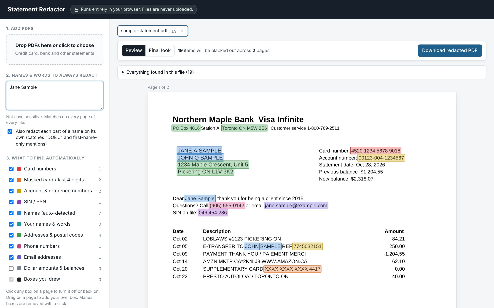

# Statement Redactor

**Live demo: [kbarakzai7.github.io/statement-redactor](https://kbarakzai7.github.io/statement-redactor/)**

A browser app that finds and removes personal information from PDF statements and credit reports (credit card, bank, utility, Equifax, TransUnion) before you share them with a landlord, accountant, lender or employer. Files never leave your computer.



## The problem

People are routinely asked for bank or credit card statements as proof of income, address or expenses. Sharing them exposes card numbers, account numbers, a home address and sometimes a Social Insurance Number. The existing options each fall short:

- Desktop tools such as Adobe Acrobat Pro are paid and require you to select every item by hand.
- Online redaction services detect items automatically, but you have to upload your statement to their servers.
- Free open-source tools need self-hosting and ask you to write the search patterns yourself.

Statement Redactor detects sensitive items automatically, runs entirely on your own machine, and needs no installation or account.

## Features

- **Automatic detection** of card numbers (validated with the Luhn checksum), masked card digits, account and transit numbers, Social Insurance Numbers, dates of birth, names and aliases, employers, street addresses, postal codes, phone numbers and email addresses
- **Canadian formats built in**: SIN validation, postal codes, province abbreviations, transit-institution-account numbers, French street names
- **Name discovery**: finds names from labels ("Cardholder:"), mailing address blocks and salutations, then redacts every other mention across all pages
- **Human review**: colour-coded boxes by category, click any box to keep it visible, drag to add your own
- **Batch processing**: several PDFs at once
- **Verified output**: each page is flattened to an image with the redactions burned in, then the new file is reopened and checked to confirm no readable text or original metadata survived

## How it works

1. **Text extraction.** PDF.js reads each page's text layer with exact positions. Fragments are grouped into lines by baseline, preserving column gaps so patterns do not match across table columns.
2. **Detection.** Each line runs through a set of category rules. Matches are deduplicated by priority, so a card number is not also flagged as a generic account number.
3. **Positioning.** Character ranges are mapped back to page coordinates by measuring glyph widths, so boxes cover only the sensitive text instead of whole lines.
4. **Redaction.** Pages are rendered to images at the chosen resolution, black boxes are drawn on, and pdf-lib assembles a new PDF from the images. Nothing from the original file's text layer, fonts, annotations or metadata is copied over.
5. **Verification.** The output is parsed again and must contain zero extractable characters before the download is offered.

Redacting by flattening is a deliberate trade-off: the output is not searchable, but there is no hidden text left under a black box to copy out, which is the most common way redactions fail.

## Privacy by design

- No server, no account, no analytics, no network requests. The PDF libraries are bundled into the page.
- `index.html` works offline from a local folder.

## Install it as an app

The live site installs like a regular app and then works offline.

- **iPhone or iPad:** open the live demo in Safari, tap **Share**, then **Add to Home Screen**.
- **Android:** open it in Chrome, tap the **⋮** menu, then **Install app**.
- **Windows, Mac or Linux:** open it in Chrome or Edge and click the install icon at the right end of the address bar. In Safari on a Mac, choose **File > Add to Dock**.

On desktop Chrome and Edge, the installed app can also be set to open PDFs directly ("Open with").

## Run it locally

Download this repository (green **Code** button, then **Download ZIP**), unzip it, and double-click `index.html`. Try it with `examples/sample-statement.pdf`, a fictional statement.

## Limitations

- Detection is rule based and can miss unusual formats. Always review every page.
- Scanned statements (image-only pages) are not read automatically. The app flags them so you can draw boxes by hand.
- Password-protected PDFs must be unlocked first.

## Roadmap

- Optical character recognition for scanned statements
- Saved detection profiles for specific banks
- Browser extension packaging

## Tech stack

JavaScript, HTML and CSS with no framework. [PDF.js](https://mozilla.github.io/pdf.js/) for parsing and rendering, [pdf-lib](https://pdf-lib.js.org/) for building the output, Node.js for the build step.

## Development

The source is `src/template.html`. To rebuild `index.html` after editing:

```
npm install
npm run build
```

## Licenses

Includes PDF.js (Apache License 2.0) and pdf-lib (MIT License). See [THIRD_PARTY_LICENSES.md](THIRD_PARTY_LICENSES.md).
